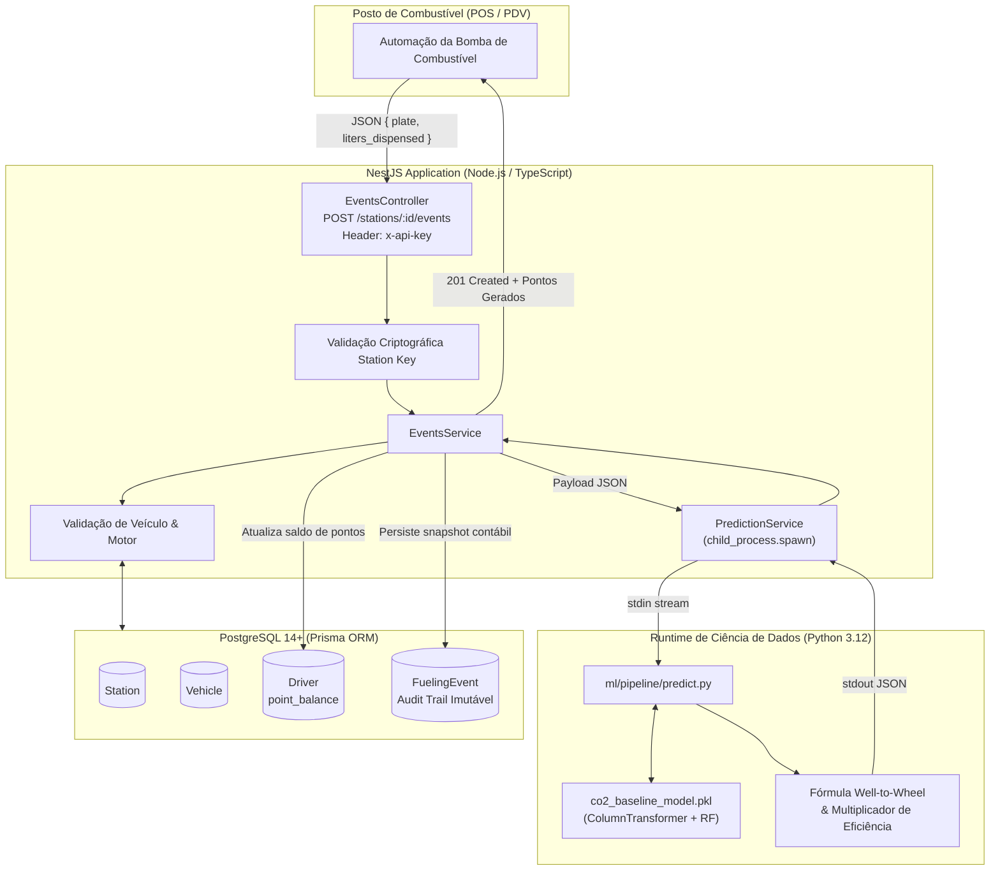

# BioPoints - Plataforma de Fidelidade & Crédito de Carbono no Abastecimento

> Converte emissões evitadas de CO₂ no abastecimento com biodiesel em pontos de fidelidade para motoristas via Machine Learning contrafactual e integração em tempo real.

**Status:** MVP Concluído (🏆 **1º Lugar: Hackathon LIAO/UFBA 2026**)  
**Período:** 20 a 22 de maio de 2026 (Maratona de 48 horas)  
**Papel:** Cientista de Dados & Engenheiro de Machine Learning (Equipe Hexagon, com Samuel Cesar e Marcelo Araújo Silva)  
**Repositório Oficial:** [github.com/sCesar-dev/hackathon_baIA_2026](https://github.com/sCesar-dev/hackathon_baIA_2026)  
**Relatórios Técnicos:** [Baixar Relatório Completo (PT)](/docs/Relatorio_Treino_Predicao_BioPoints_PT.pdf) · [Download Technical Report (EN)](/docs/Training_Prediction_Report_BioPoints_EN.pdf)

---

## 🎯 1. Elevator Pitch & O Problema Real

A maioria dos motoristas e frotistas não adota biocombustíveis porque não enxerga vantagem financeira imediata na bomba de combustível, enquanto os programas de fidelidade convencionais ignoram o impacto ecológico.

O **BioPoints** resolve isso conectando o sistema do posto de combustível (PDV/POS) a um modelo preditivo de **Machine Learning** que calcula, a cada abastecimento com biodiesel, o volume contrafactual de CO₂ que aquele veículo deixaria de emitir caso estivesse utilizando diesel fóssil. Esse cálculo é ponderado pela eficiência energética real do veículo e convertido instantaneamente em pontos resgatáveis na carteira digital do condutor.

Desenvolvido sob a pressão de 48 horas, o projeto conquistou o **1º lugar no Hackathon da Liga de Inteligência Artificial e Otimização da UFBA (LIAO)**, comprovando viabilidade técnica e incentivo econômico direto à transição energética.

### A Dor e o Impacto no Negócio:
* **Quem sofre:** Motoristas autônomos, frotistas urbanos e redes de postos interessadas em atrair consumidores conscientes e acelerar metas ESG em grandes centros urbanos (piloto modelado para Salvador/BA).
* **Qual é o gargalo:** O biodiesel (B100 ou blendas elevadas) compete diretamente com o diesel fóssil. No momento da compra, o motorista não recebe retorno tangível que justifique a escolha sustentável. Ao mesmo tempo, cashback convencional premia apenas o gasto financeiro bruto, bonificando indiferentemente veículos poluentes e eficientes.
* **Por que importa:** Sem incentivo econômico tangível na ponta final da cadeia de consumo, a transição para matrizes limpas em cidades inteligentes fica represada por inércia mercadológica.

---

## 🔬 2. Ciência de Dados & Modelagem Preditiva

Como responsável pela inteligência de dados, tratamento, treinamento e predição do dataset, a missão foi transformar dados brutos de homologação veicular no motor contrafactual de negócio da plataforma.

```
┌────────────────────────────────────────────────────────────────────────┐
│                   PIPELINE DE MACHINE LEARNING                         │
└──────────────────────────────────┬─────────────────────────────────────┘
                                   │
         ┌─────────────────────────┴─────────────────────────┐
         │                                                   │
   ┌─────▼──────────────┐                             ┌──────▼─────────────┐
   │ Variáveis Numéricas│                             │ Variáveis Categór. │
   │ Engine Size, Cyl., │                             │ Transm., Fuel Type,│
   │ Fuel Consumption   │                             │ Vehicle Class      │
   └─────┬──────────────┘                             └──────┬─────────────┘
         │ passthrough                                       │ OneHotEncoder
         └─────────────────────────┬─────────────────────────┘
                                   │
                         ┌─────────▼──────────┐
                         │ ColumnTransformer  │
                         └─────────┬──────────┘
                                   │
                      ┌────────────▼─────────────┐
                      │  Random Forest Regressor │
                      │      (100 árvores)       │
                      └────────────┬─────────────┘
                                   │
                  ┌────────────────┴────────────────┐
                  ▼                                 ▼
         R² Score: 0.9964                  MAE: 1.9035 g/km
```

### Formulação Contrafactual e Regras de Negócio

1. **Predição Contrafactual de Emissões Fósseis ($CO_{2,\text{fóssil}}$):**  
   O modelo não prevê o biodiesel diretamente, mas estima a emissão de referência fóssil que aquele motor específico produziria por quilômetro:
   $$\text{co2\_fossil\_predicted\_g\_km} = \mathcal{M}_{\text{RF}}(\text{motor, cilindros, transmissão, consumo})$$

2. **Cálculo de Emissões Evitadas no Ciclo de Vida (Well-to-Wheel):**  
   Aplicamos o fator de redução de 70% validado pela literatura de biocombustíveis (`BIOFUEL_CO2_FACTOR = 0.30`):
   $$\text{co2\_biofuel\_actual} = \text{co2\_fossil\_predicted} \times 0.30$$
   $$\text{co2\_saved\_g\_km} = \text{co2\_fossil\_predicted} - \text{co2\_biofuel\_actual}$$

3. **Multiplicador de Eficiência Energética Limitado:**  
   Normaliza o consumo combinado contra a média da base ($\bar{C} = 12.94\text{ L/100km}$), com travas para não bonificar consumo desregulado:
   $$\text{multiplier} = \min\left(\max\left(\frac{12.94}{\text{consumo}}, 0.5\right), 2.0\right)$$

4. **Conversão Instantânea em BioPoints:**  
   $$\text{points\_awarded} = \text{co2\_saved\_g\_km} \times \text{multiplier} \times \text{litros} \times 0.01$$

---

## 📊 3. Validação Estatística & Métricas Comprovadas

A validação foi conduzida sobre **7.385 amostras veiculares** com split hold-out estrito 80/20 ($n_{\text{teste}} = 1.477$).

| Métrica | Modelo Principal (com Consumo) | Modelo de Segurança (sem Consumo) |
|---|---|---|
| **R² Score** | **0.9964** (99,64% de variância explicada) | **0.9304** (93,04% de variância explicada) |
| **MAE (Mean Absolute Error)** | **1.9035 g/km** | **11.0617 g/km** |
| **Correlação Pearson (Consumo x CO₂)** | **0.9181** | N/A |
| **Distribuição de Resíduos** | Média zero, simétrica, homocedástica | Dispersão controlada em extremos |

### Gráficos de Avaliação do Modelo

* **Confirmação de Predição (Dispersão Predito vs. Real):** Alinhamento quase perfeito à bissetriz ($y = x$), demonstrando generalização uniforme sem viés sistemático.
* **Curva de Densidade KDE:** Sobreposição milimétrica entre a curva de densidade real do dataset e a densidade predita pelo ensemble de árvores.
* **Análise de Resíduos:** Concentração estrita em torno de zero, atestando resiliência a outliers e confiabilidade para fins contábeis e fiscais.

---

## 🏛️ 4. Arquitetura de Software & Integração IPC



### Decisões de Engenharia & Desafios Superados
* **Comunicação Interprocessos por Streams (`stdin` / `stdout`):** Em vez de instanciar servidores HTTP adicionais durante o hackathon de 48h, conectamos o NestJS ao interpretador Python via `child_process.spawn`. O payload trafega por pipes de memória do kernel Linux com latência média de **~150ms**.
* **Prevenção de Data Leakage:** Encapsulamento estrito do `ColumnTransformer` e `OneHotEncoder(handle_unknown='ignore')` dentro do pipeline serializado via `joblib`, impedindo que classes veiculares ausentes na base derrubem a inferência em produção.
* **Integridade e Auditoria ESG:** Registro imutável em `FuelingEvent` persistindo os valores de $CO_{2,\text{fóssil}}$, $CO_{2,\text{bio}}$, emissões evitadas e o multiplicador de eficiência no momento da transação.

---

## 📽️ 5. Galeria de Slides do Pitch & Registros Visuais

Os slides oficiais da apresentação da equipe Hexagon perante a banca examinadora do Hackathon da LIAO / Instituto de Computação da UFBA, gráficos de regressão e diagramas arquiteturais estão disponíveis para visualização interativa no carrossel de mídia acima.

---

## 📥 6. Relatórios Técnicos Oficiais para Download

Para total transparência metodológica, os experimentos e métricas foram compilados em relatórios técnicos formais:

- 📄 **[Download: Relatório de Treino e Predição: BioPoints (Português, PDF)](/docs/Relatorio_Treino_Predicao_BioPoints_PT.pdf)**
- 📄 **[Download: Training and Prediction Report: BioPoints (English, PDF)](/docs/Training_Prediction_Report_BioPoints_EN.pdf)**
